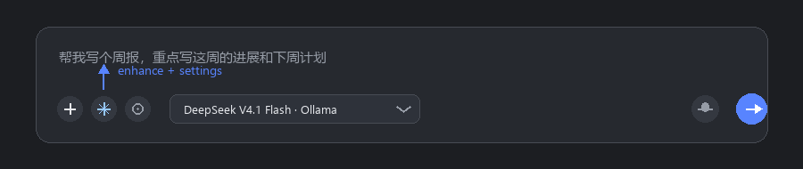

# Prompt enhancement for DeepSeek Harness

English | [简体中文](./README.zh-CN.md)

[](https://github.com/mowei1600/dsh-enhanced-prompt/actions/workflows/ci.yml)
[](./LICENSE)
[](./package.json)

Turn a rough one-line request into **one ready-to-send prompt** — rewritten by the model you
already use, with **this conversation's context**, without leaving the composer.

- ✦ button next to the model selector: click it and your draft is replaced in place by the
  rewritten prompt (with a one-click **Restore**).
- `/enhance` slash command and an `enhance_prompt` tool for agents.
- ⚙ settings panel: rewrite mode, output style/length, language, conversation context, model,
  timeout and a free-form extra requirement.
- Everything is a normal DSH bundle: Host + web client, no patched harness files, no telemetry.



> The screenshot is a hand-drawn mock of the two controls' placement (they sit in the composer's
> bottom control row, immediately left of the model selector). Add your own screenshot under
> `docs/assets/composer.png` before publishing if you want a real one.

## Install

Requirements: DeepSeek Harness `0.2.1-rc.4` or newer, Node.js ≥ 18, and Git.

### Option A — install straight from GitHub (recommended)

In a DSH session with the plugin manager available (Creator preset, `danger-full-access`):

```jsonc
// plugin_manager tool
{ "action": "install_bundle", "target": "github:mowei1600/dsh-enhanced-prompt" }
```

DSH verifies the repository with `git ls-remote` and installs it through pnpm; the bundle is
selected automatically. You can also paste the plain repository URL as `target`:
`https://github.com/mowei1600/dsh-enhanced-prompt`.

### Option B — one-liner installer (clone + local install)

PowerShell:

```powershell
irm https://raw.githubusercontent.com/mowei1600/dsh-enhanced-prompt/main/scripts/install.ps1 | iex
```

bash / zsh:

```bash
curl -fsSL https://raw.githubusercontent.com/mowei1600/dsh-enhanced-prompt/main/scripts/install.sh | sh
```

Both scripts clone the repository to a temporary directory, then run the bundled installer with
`--profile desktop` (edit the script or pass `-Profile <name>` / `--profile <name>` to change it).

### Option C — clone and install manually

```bash
git clone https://github.com/mowei1600/dsh-enhanced-prompt.git
cd dsh-enhanced-prompt
node bin/install.mjs install --profile desktop
node bin/install.mjs status  --profile desktop --json
```

The installer links the checkout into `$DSH_HOME/plugins/dsh-enhanced-prompt` and the profile's
`node_modules`, declares the dependency, selects the bundle and writes the managed config block
into the profile's `cordis.patch.yml`, snapshotting the touched profile files first.

**After installing, refresh the page** (`Ctrl+R` / `Cmd+R`) so the composer button loads, and
restart DSH if the plugin still is not listed in the Host log.

### Updating / uninstalling

```bash
git pull && node bin/install.mjs install --profile desktop   # update (Option B/C)
node bin/install.mjs uninstall --profile desktop             # remove
```

For Option A, use the plugin manager's update/remove actions instead.

## Usage

| Where | What it does |
|---|---|
| Composer row | ✦ rewrites the draft in place (model call, spends tokens); ↩ restores the pre-rewrite text |
| ⚙ panel | rewrite mode, style, length, language, conversation context (turns / character cap), model, timeout, extra requirement |
| `/enhance <request>` | preview the rewrite in chat (`apply` sends it as the next message, `preset`/`lang` switch the offline engine's template, `status`/`settings`/`set` inspect or change settings) |
| `enhance_prompt` tool | lets an agent restate a vague request before working on it |

The rewrite is deliberately the **prompt itself**: no section headings, no "to fill in"
placeholders, no quoted original — just the text you would have typed if you had been precise.

## Configuration

Runtime settings live in `$DSH_HOME/enhanced-prompt.settings.json` and are editable from the ⚙
panel or `/enhance set key=value`. Deployment defaults come from the bundle patch and can be
overridden in the profile's `cordis.patch.yml`:

```yaml
- id: enhanced-prompt
  config:
    enabled: true
    strategy: llm            # llm = model rewrite (tokens) | rule = offline engine
    style: natural           # natural = prompt text | structured = sectioned template
    length: normal           # short | normal | detailed
    language: auto           # auto | zh | en
    extraInstruction: ''
    history: { enabled: true, messages: 6, chars: 2000 }
    llm:
      provider: ''           # empty = follow the profile default model
      model: ''
      maxOutputTokens: 1400
      temperature: 0.2
      timeoutMs: 45000
      fallbackToRule: false
    bridge: { enabled: true, maxInFlight: 2 }
    diagnostics: true
```

`/enhance status` prints the effective configuration, including the resolved model route.

## Security & privacy

- Rewriting happens in the **Host** through `ctx.llm`; the browser never sees provider
  credentials.
- The composer button talks to one same-origin endpoint, `POST /enhance/api`: POST + JSON only,
  body capped, one in-flight rewrite per session, Origin checked when present.
- The draft and the conversation tail are only used for the rewrite request; the plugin writes
  nothing to the session log and nothing to disk except its own settings file.
- The offline `rule` engine never calls a model (useful for air-gapped setups).

## Development

```bash
npm test                 # 85 unit tests: engine, host wiring, client bundle, LLM/bridge, settings/history
npm run check:client     # client.js is up to date with client/ui.js
npm run check:text       # no BOM / CRLF / replacement characters in text files
npm run build:client     # regenerate client.js after editing client/ui.js
```

Layout:

```
index.js               Host plugin: config, commands, tool, prompt section, HTTP bridge
lib/                   llm (model rewrite), bridge, settings, history, offline engine
client/ui.js           composer controls (template)  ->  client.js (generated bundle)
bin/install.mjs        local installer (install / uninstall / status)
scripts/               bundle build, text check, one-line installers
docs/                  design, verification log, API recon notes
```

See [CONTRIBUTING.md](./CONTRIBUTING.md) for the workflow, [CHANGELOG.md](./CHANGELOG.md) for
releases, and [docs/design.md](./docs/design.md) for the architecture.

## Compatibility

Written against DSH `0.2.1-rc.4` APIs (`ctx.commands`, `ctx.tools`, `ctx.systemPrompt`,
`ctx.webServer`, `ctx.llm`, `ctx.sessions`, `ctx.agentDefaultModel`) and the
`conversation.input.right` client slot. Capabilities register only when their service exists, so
minimal profiles simply get fewer surfaces.

## License

[MIT](./LICENSE). This is an independent implementation; it shares no prompt text, assets or
branding with any third-party product it is compared against in `docs/`.
